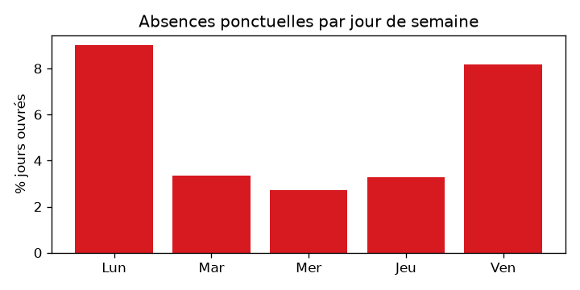
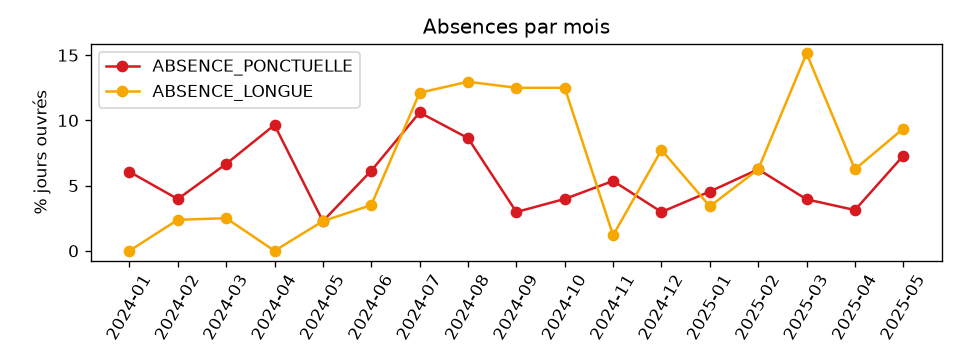
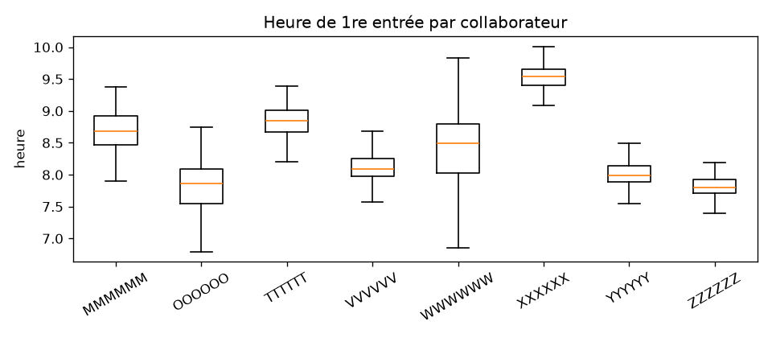

# Profil des données de pointage

> Généré automatiquement par `ml-service/analysis/profile_data.py` à partir de `data/raw/Pointage_PFA.xls`. Ne pas éditer à la main.

## 1. Structure du fichier

- 8 feuilles (une par collaborateur) : MMMMMM, OOOOOO, TTTTTT, VVVVVV, WWWWWW, XXXXXX, YYYYYY, ZZZZZZ.
- **11 367 pointages** au total (la spec annonçait ~12 400 : il s'agissait d'une estimation, le fichier contient 11 367 lignes horodatées).
- Période couverte : du 02/01/2024 au 19/05/2025.
- En-tête en ligne 2 (`_Time | User_ID | User_Name | Terminal_Name`) ; la feuille `TTTTTT` a une 1re colonne `ordre`, les autres une colonne vide → colonnes détectées par nom.
- `User_ID` est identique au nom de la feuille pour toutes les lignes.
- **Notes d'embauche trouvées dans le fichier** (colonne hors en-tête) : `MMMMMM` → 06/08/2024, `OOOOOO` → 06/08/2024. Elles sont utilisées comme dates d'embauche réelles ; les autres dates d'embauche sont fictives (seed).

| sheet | pointages | premier | dernier | jours_avec_pointage |
|---|---|---|---|---|
| MMMMMM | 972 | 06/08/2024 | 16/05/2025 | 186 |
| OOOOOO | 759 | 06/08/2024 | 19/05/2025 | 193 |
| TTTTTT | 1623 | 03/01/2024 | 19/05/2025 | 322 |
| VVVVVV | 2795 | 02/01/2024 | 15/05/2025 | 301 |
| WWWWWW | 905 | 04/01/2024 | 19/05/2025 | 312 |
| XXXXXX | 739 | 04/01/2024 | 19/05/2025 | 210 |
| YYYYYY | 1836 | 02/01/2024 | 19/05/2025 | 322 |
| ZZZZZZ | 1738 | 02/01/2024 | 19/05/2025 | 319 |

## 2. Terminaux

`Terminal_Name` = sens + porte, avec espaces multiples (`Sortie  TB`). Normalisation : trim + espaces simples ; 1er mot → sens (`Entr…` = IN, `Sortie` = OUT), reste → porte.

| terminal | IN | OUT | frontière bâtiment |
|---|---|---|---|
| SS1 A | 2 | 0 | non (zone interne) |
| SS1 B | 797 | 798 | non (zone interne) |
| SS2 A | 0 | 1 | non (zone interne) |
| SS2 B | 6 | 19 | non (zone interne) |
| TA | 22 | 15 | oui |
| TB | 4870 | 4837 | oui |

- 14.3% des pointages concernent des portes internes (SS1/SS2) : ce sont des mouvements entre zones, **pas des sorties du bâtiment**.

## 3. Doublons

- Doublons exacts (même seconde, même porte) : **9**.
- Doublons proches (même sens, même porte, écart ≤ s secondes) : ≤5s : 40, ≤30s : 81, ≤60s : 83, ≤120s : 83, ≤300s : 85.
- La courbe sature dès 60 s : on retient **120 s** comme seuil de dédoublonnage (paramètre `app_settings.duplicate_window_seconds`). Les doublons sont conservés dans `raw_punch` mais marqués et ignorés dans les calculs.

## 4. Qualité des journées

- Journées avec au moins un pointage : 2165.
- Journées avec un nombre **impair** de pointages frontière (pointage manquant) : **58** (2.7%).
- Journées avec pointages mais sans entrée frontière : 1.
- Journées de week-end travaillées : 7 (MMMMMM Sat 01/02/2025, MMMMMM Sun 02/02/2025, MMMMMM Sat 26/04/2025, OOOOOO Sat 01/02/2025, OOOOOO Sun 02/02/2025, OOOOOO Sat 19/04/2025, OOOOOO Sat 26/04/2025).

## 5. Jours fériés détectés

Jours ouvrés (lun–ven) où **personne** n'a pointé, comparés au calendrier `public_holiday` :

| Date | Jour | Dans le calendrier |
|---|---|---|
| 20/03/2024 | Mer | Fête de l'Indépendance |
| 09/04/2024 | Mar | Journée des Martyrs |
| 10/04/2024 | Mer | Aïd el-Fitr |
| 11/04/2024 | Jeu | Aïd el-Fitr (2e jour) |
| 01/05/2024 | Mer | Fête du Travail |
| 17/06/2024 | Lun | Aïd el-Adha (2e jour) |
| 25/07/2024 | Jeu | Fête de la République |
| 13/08/2024 | Mar | Fête de la Femme |
| 15/10/2024 | Mar | Fête de l'Évacuation |
| 17/12/2024 | Mar | Fête de la Révolution |
| 01/01/2025 | Mer | Jour de l'An |
| 20/03/2025 | Jeu | Fête de l'Indépendance |
| 31/03/2025 | Lun | Aïd el-Fitr (2e jour) |
| 01/04/2025 | Mar | Aïd el-Fitr (3e jour) |
| 09/04/2025 | Mer | Journée des Martyrs |
| 01/05/2025 | Jeu | Fête du Travail |

- Fériés du calendrier tombant un jour ouvré mais avec des pointages : aucun.
- Le 14/01/2025 (mardi) est travaillé : confirme que la Fête de la Révolution est désormais le **17 décembre** (décret 2021), pas le 14 janvier.

## 6. Jours sans pointage et absences

- Jours-personnes ouvrés (du début de suivi au 19/05/2025) : **2456** ; sans pointage : 298 (12.1%).
- dont `ABSENCE_PONCTUELLE` (1–2 jours consécutifs) : **132** (5.4%) ;
- dont `ABSENCE_LONGUE` (≥ 3 jours, congé probable) : **166** (6.8%).

| emp | jours_ouvres | sans_pointage | ponctuelles | longues | plus_longue_série | taux_ponctuelle |
|---|---|---|---|---|---|---|
| MMMMMM | 196 | 13 | 5 | 8 | 5 | 2.6% |
| OOOOOO | 196 | 7 | 4 | 3 | 3 | 2.0% |
| TTTTTT | 344 | 22 | 16 | 6 | 6 | 4.7% |
| VVVVVV | 344 | 43 | 34 | 9 | 9 | 9.9% |
| WWWWWW | 344 | 32 | 16 | 16 | 9 | 4.7% |
| XXXXXX | 344 | 134 | 22 | 112 | 51 | 6.4% |
| YYYYYY | 344 | 22 | 22 | 0 | 2 | 6.4% |
| ZZZZZZ | 344 | 25 | 13 | 12 | 9 | 3.8% |

Répartition des séries d'absence par longueur (jours ouvrés consécutifs) :

| longueur | nb_séries |
|---|---|
| 1 | 70 |
| 2 | 31 |
| 3 | 7 |
| 4 | 2 |
| 5 | 2 |
| 6 | 1 |
| 7 | 1 |
| 9 | 3 |
| 36 | 1 |
| 51 | 1 |

Taux d'absence ponctuelle par jour de semaine : Lun 9.0%, Mar 3.4%, Mer 2.7%, Jeu 3.3%, Ven 8.2%.

Effet calendrier (veille / lendemain de jour férié, en tenant compte des week-ends) :

| near_hol | jours | taux_ponctuelle |
|---|---|---|
| autre | 2248 | 4.4% |
| lendemain | 114 | 18.4% |
| veille | 94 | 13.8% |

_Remarque : 29 fériés seulement → effectifs faibles, effet à interpréter avec prudence._

## 7. Horaires d'arrivée

Horaire de référence par défaut = médiane de la 1re entrée sur les 60 premiers jours de suivi, arrondie au quart d'heure (règle de la spec).

| collaborateur | médiane 1re entrée | médiane 60 premiers jours | horaire de référence (¼ h) | P10–P90 | taux de retard (réf + 10 min) | retard moyen quand en retard |
|---|---|---|---|---|---|---|
| MMMMMM | 8h41 | 8h26 | 8h30 | 8h19–9h07 | 52.2% | 36 min |
| OOOOOO | 7h52 | 7h45 | 7h45 | 7h14–8h19 | 44.8% | 27 min |
| TTTTTT | 8h51 | 9h02 | 9h00 | 8h31–9h11 | 11.8% | 40 min |
| VVVVVV | 8h06 | 8h03 | 8h00 | 7h50–8h28 | 36.5% | 26 min |
| WWWWWW | 8h29 | 8h10 | 8h15 | 7h27–9h03 | 53.8% | 44 min |
| XXXXXX | 9h32 | 9h41 | 9h45 | 9h17–9h47 | 5.7% | 26 min |
| YYYYYY | 7h59 | 8h04 | 8h00 | 7h45–8h21 | 21.7% | 29 min |
| ZZZZZZ | 7h48 | 7h56 | 8h00 | 7h39–8h00 | 2.8% | 52 min |

Les taux de retard élevés de certains collaborateurs (MMMMMM, WWWWWW) viennent d'une dérive de l'heure d'arrivée après les 60 premiers jours : la règle de la spec est appliquée telle quelle, l'horaire reste modifiable par RH dans l'administration.

Médiane de 1re entrée par type de période :

| user_id | NORMAL | RAMADAN | SEANCE_UNIQUE |
|---|---|---|---|
| MMMMMM | 8h42 | 8h43 | 8h24 |
| OOOOOO | 7h55 | 7h20 | 7h34 |
| TTTTTT | 8h54 | 8h38 | 8h43 |
| VVVVVV | 8h05 | 8h11 | 8h07 |
| WWWWWW | 8h36 | 8h12 | 8h17 |
| XXXXXX | 9h35 | 9h16 | 9h21 |
| YYYYYY | 8h00 | 7h59 | 7h13 |
| ZZZZZZ | 7h50 | 7h47 | 7h47 |

**Constat** : les heures d'arrivée ne changent pas significativement pendant le Ramadan ni l'été (juillet–août). Les périodes spéciales sont donc créées dans `special_period` **sans horaire imposé par défaut** (l'horaire personnel reste la référence) ; RH peut y saisir un horaire propre qui remplacera alors l'horaire personnel.

## 8. Heures travaillées (journées complètes)

| emp | médiane | moyenne | journées complètes | journées incomplètes |
|---|---|---|---|---|
| MMMMMM | 7h00 | 6h42 | 179 | 7 |
| OOOOOO | 8h25 | 8h35 | 184 | 9 |
| TTTTTT | 6h34 | 6h12 | 321 | 1 |
| VVVVVV | 7h40 | 7h17 | 280 | 21 |
| WWWWWW | 8h01 | 7h40 | 306 | 6 |
| XXXXXX | 4h59 | 5h10 | 208 | 2 |
| YYYYYY | 7h09 | 6h59 | 312 | 10 |
| ZZZZZZ | 7h55 | 7h31 | 317 | 2 |

Les journées incomplètes (pointage impair ou séquence IN/OUT incohérente) sont marquées `incomplete = true` ; leurs heures ne sont pas inventées et elles sont exclues des moyennes d'heures.

## 9. Synthèse pour la modélisation

- Échantillon très petit : 8 collaborateurs, 2456 jours-personnes ouvrés, 132 jours d'absence ponctuelle (classe positive rare, ~5%).
- Une grande part des jours sans pointage sont des absences longues (congés probables) : exclues de la cible ponctuelle.
- Horaires hétérogènes → retard calculé relativement à l'horaire de référence personnel.
- Pas de congés déclarés ni de hiérarchie dans le fichier → table `leave` vide au départ, hiérarchie fictive (seed).
