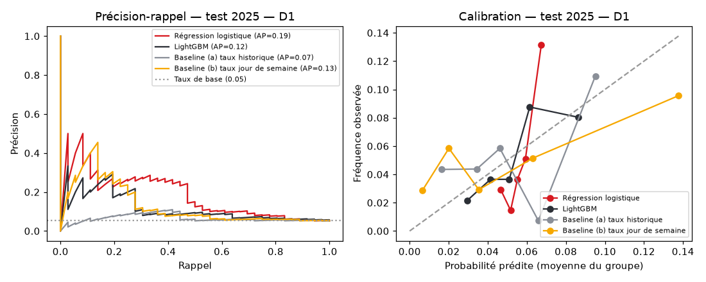
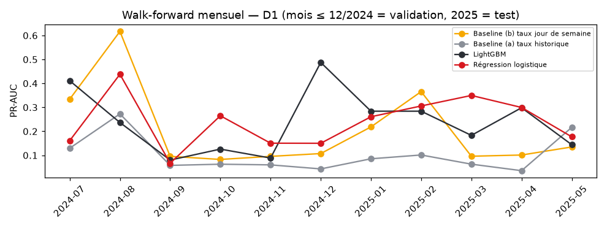
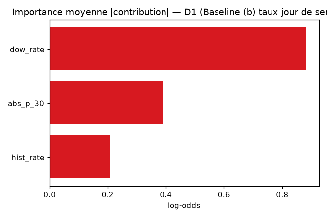
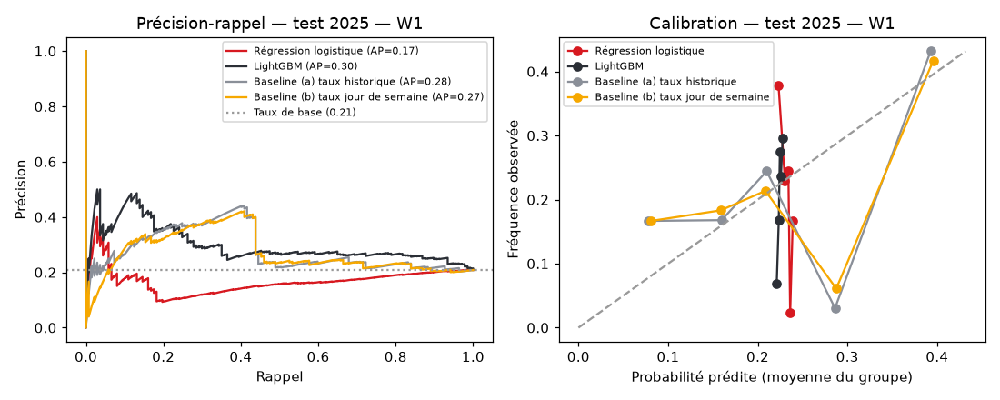
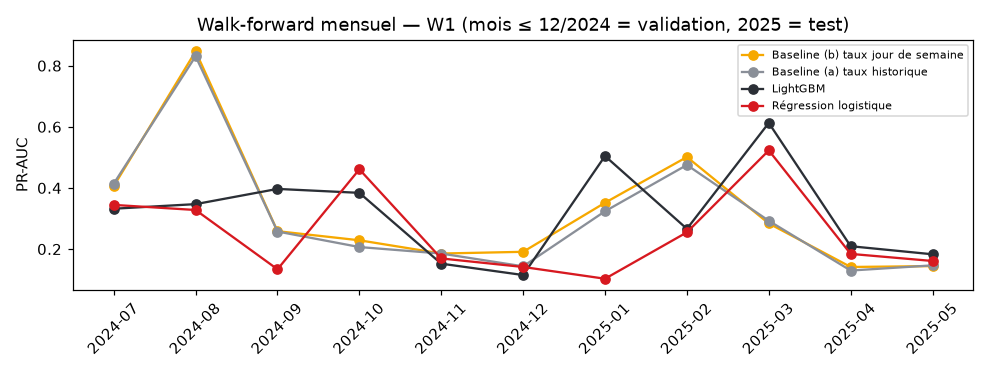
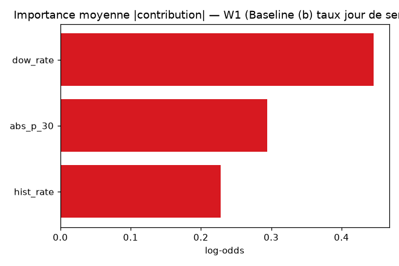

# Model card — risque d'absence ponctuelle (version `v20261028-155209`)

> Généré automatiquement par `python -m pipeline.train` à partir d'une exécution réelle. Ne pas éditer à la main.

## Usage prévu et usages interdits

- **Usage prévu** : outil d'aide à l'anticipation pour l'organisation du travail (planification, continuité de service) par les RH et les responsables N+1.
- **Usages interdits** : évaluation individuelle, notation, sanction, décision RH automatisée, toute utilisation disciplinaire. Les facteurs affichés sont des facteurs **associés** à l'estimation, jamais des causes.
- Aucune estimation n'est affichée pour un collaborateur ayant moins de 30 jours ouvrés d'historique.
- Conformité : loi organique tunisienne n° 2004-63 (protection des données personnelles) — minimisation (seuls les pointages sont utilisés), accès restreint par rôle, traçabilité des consultations.

## Données

- Données **réelles uniquement** : 8 collaborateurs, journées du 2024-01-02 au 2025-05-19 (`daily_attendance`).
- Cible D1 : `ABSENCE_PONCTUELLE` au prochain jour ouvré. Cible W1 : au moins une absence ponctuelle dans les 5 prochains jours ouvrés (modèle direct).
- Exclus des échantillons : jours cibles en congé déclaré ou en absence longue (≥ 3 jours), week-ends, fériés ; échantillons avec moins de 20 jours d'historique.
- Split temporel : entraînement = cibles ≤ 31/12/2024 ; test = cibles en 2025. Validation walk-forward mensuelle (sélection sur juillet–décembre 2024 uniquement).

## Horizon J+1 (prochain jour ouvré)

- Échantillons : 1444 en entraînement, 686 en test (taux de positifs test : 5.2%).
- Modèle retenu : **Aucun modèle ne bat la meilleure baseline en validation** : c'est la baseline **Baseline (b) taux jour de semaine** qui est utilisée en production (règle de non-promotion).
- Seuils de risque (probabilités calibrées, quantiles 70 % / 90 % de la validation) : MODÉRÉ ≥ 0.066, ÉLEVÉ ≥ 0.136.

### Validation walk-forward (juillet–décembre 2024, agrégée)

| Modèle | PR-AUC | ROC-AUC | Brier | Précision@3 |
|---|---|---|---|---|
| Régression logistique | 0.108 | 0.532 | 0.060 | 0.070 |
| LightGBM | 0.152 | 0.647 | 0.059 | 0.096 |
| Baseline (a) taux historique | 0.091 | 0.633 | 0.059 | 0.094 |
| Baseline (b) taux jour de semaine | 0.162 | 0.739 | 0.057 | 0.104 |

### Test 2025 (modèles entraînés sur 2024)

| Modèle | PR-AUC | ROC-AUC | Brier | Précision@3 |
|---|---|---|---|---|
| Régression logistique | 0.193 | 0.717 | 0.049 | 0.079 |
| LightGBM | 0.124 | 0.654 | 0.049 | 0.075 |
| Baseline (a) taux historique | 0.067 | 0.562 | 0.050 | 0.061 |
| Baseline (b) taux jour de semaine ← retenu | 0.135 | 0.614 | 0.049 | 0.068 |

Au seuil ÉLEVÉ, le modèle retenu signale 9.8% des cas de test, avec un rappel de 0.278 et une précision de 0.149 ; au seuil MODÉRÉ : rappel 0.472, précision 0.084.

PR-AUC mensuelle (walk-forward) :

| Mois | positifs | Baseline (b) taux jour de semaine | Baseline (a) taux historique | LightGBM | Régression logistique |
|---|---|---|---|---|---|
| 2024-07 | 14.000 | 0.334 | 0.130 | 0.411 | 0.161 |
| 2024-08 | 14.000 | 0.617 | 0.273 | 0.237 | 0.438 |
| 2024-09 | 5.000 | 0.096 | 0.058 | 0.080 | 0.067 |
| 2024-10 | 7.000 | 0.083 | 0.063 | 0.126 | 0.265 |
| 2024-11 | 9.000 | 0.096 | 0.060 | 0.088 | 0.150 |
| 2024-12 | 5.000 | 0.107 | 0.043 | 0.488 | 0.150 |
| 2025-01 | 8.000 | 0.218 | 0.085 | 0.284 | 0.261 |
| 2025-02 | 10.000 | 0.366 | 0.101 | 0.284 | 0.306 |
| 2025-03 | 6.000 | 0.096 | 0.063 | 0.183 | 0.350 |
| 2025-04 | 5.000 | 0.101 | 0.036 | 0.298 | 0.300 |
| 2025-05 | 7.000 | 0.135 | 0.217 | 0.144 | 0.177 |

## Horizon Semaine (5 prochains jours ouvrés)

- Échantillons : 1414 en entraînement, 657 en test (taux de positifs test : 20.8%).
- Modèle retenu : **Aucun modèle ne bat la meilleure baseline en validation** : c'est la baseline **Baseline (b) taux jour de semaine** qui est utilisée en production (règle de non-promotion).
- Seuils de risque (probabilités calibrées, quantiles 70 % / 90 % de la validation) : MODÉRÉ ≥ 0.323, ÉLEVÉ ≥ 0.425.
- Nombre de jours d'absence attendu = probabilité × 1.29 (nombre moyen de jours quand la semaine contient au moins une absence, en entraînement).

### Validation walk-forward (juillet–décembre 2024, agrégée)

| Modèle | PR-AUC | ROC-AUC | Brier | Précision@3 |
|---|---|---|---|---|
| Régression logistique | 0.204 | 0.434 | 0.192 | 0.185 |
| LightGBM | 0.225 | 0.509 | 0.177 | 0.242 |
| Baseline (a) taux historique | 0.304 | 0.618 | 0.172 | 0.315 |
| Baseline (b) taux jour de semaine | 0.311 | 0.623 | 0.172 | 0.315 |

### Test 2025 (modèles entraînés sur 2024)

| Modèle | PR-AUC | ROC-AUC | Brier | Précision@3 |
|---|---|---|---|---|
| Régression logistique | 0.173 | 0.350 | 0.167 | 0.150 |
| LightGBM | 0.301 | 0.634 | 0.165 | 0.240 |
| Baseline (a) taux historique | 0.279 | 0.589 | 0.163 | 0.251 |
| Baseline (b) taux jour de semaine ← retenu | 0.270 | 0.583 | 0.165 | 0.258 |

Au seuil ÉLEVÉ, le modèle retenu signale 1.4% des cas de test, avec un rappel de 0.007 et une précision de 0.111 ; au seuil MODÉRÉ : rappel 0.438, précision 0.364.

PR-AUC mensuelle (walk-forward) :

| Mois | positifs | Baseline (b) taux jour de semaine | Baseline (a) taux historique | LightGBM | Régression logistique |
|---|---|---|---|---|---|
| 2024-07 | 42.000 | 0.406 | 0.414 | 0.332 | 0.345 |
| 2024-08 | 39.000 | 0.847 | 0.831 | 0.347 | 0.328 |
| 2024-09 | 23.000 | 0.259 | 0.258 | 0.397 | 0.134 |
| 2024-10 | 36.000 | 0.229 | 0.207 | 0.384 | 0.461 |
| 2024-11 | 29.000 | 0.186 | 0.185 | 0.152 | 0.169 |
| 2024-12 | 21.000 | 0.191 | 0.144 | 0.115 | 0.142 |
| 2025-01 | 29.000 | 0.352 | 0.324 | 0.504 | 0.103 |
| 2025-02 | 39.000 | 0.501 | 0.475 | 0.266 | 0.255 |
| 2025-03 | 34.000 | 0.284 | 0.293 | 0.613 | 0.523 |
| 2025-04 | 22.000 | 0.142 | 0.130 | 0.209 | 0.184 |
| 2025-05 | 13.000 | 0.144 | 0.147 | 0.183 | 0.161 |

## Limites connues

- **Très petit échantillon** (8 personnes, ~120 jours d'absence ponctuelle au total) : les métriques ont une forte variance, d'un mois à l'autre comme d'un modèle à l'autre. Les écarts de quelques points de PR-AUC ne sont pas significatifs.
- Les absences « longues » sont une heuristique (≥ 3 jours ouvrés consécutifs sans pointage = congé probable) faute de données de congés : certaines absences ponctuelles peuvent être des congés posés d'un ou deux jours.
- La hiérarchie, les équipes et 6 dates d'embauche sur 8 sont fictives : les features d'ancienneté et d'équipe n'ont pas de valeur explicative réelle.
- Les probabilités sont calibrées sur une période passée ; une dérive (nouvelle organisation, télétravail, recrutements) nécessite un ré-entraînement (bouton « Réentraîner »).
- Les contributions SHAP / coefficients sont calculés sur le modèle de base non calibré ; elles indiquent un sens d'association, pas un effet causal.

## Données synthétiques

Les métriques ci-dessus sont les **seules métriques officielles**. L'expérience sur données synthétiques (60 collaborateurs générés) est rapportée à part dans `synthetic_report.md` et ne doit pas être confondue avec ces résultats.
